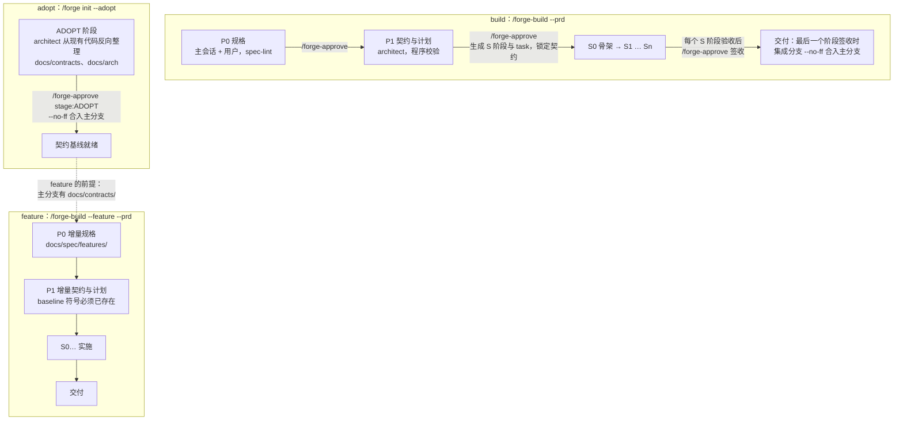
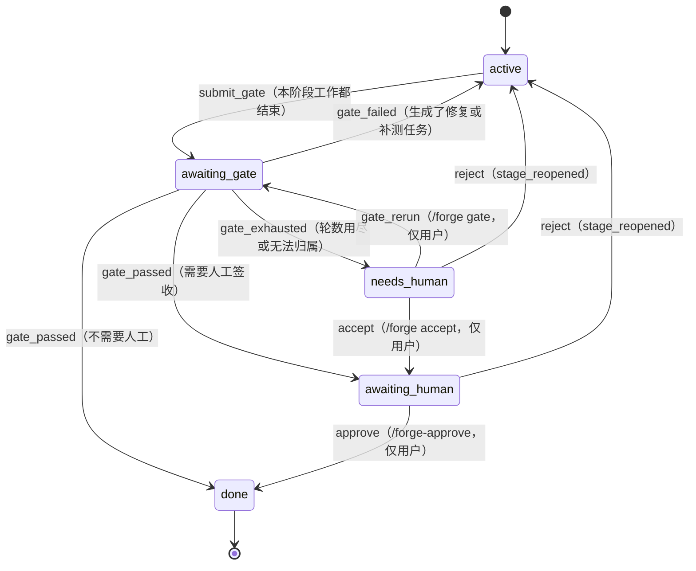
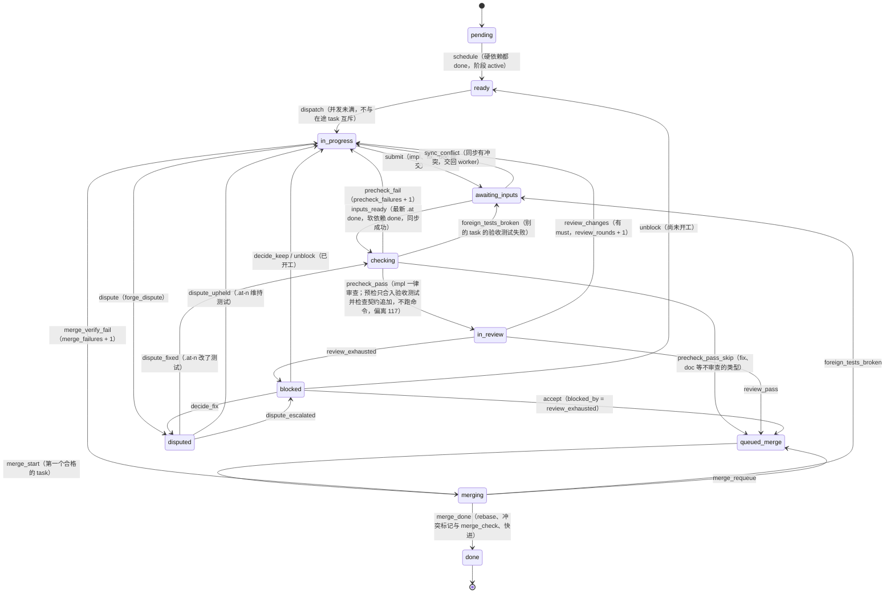
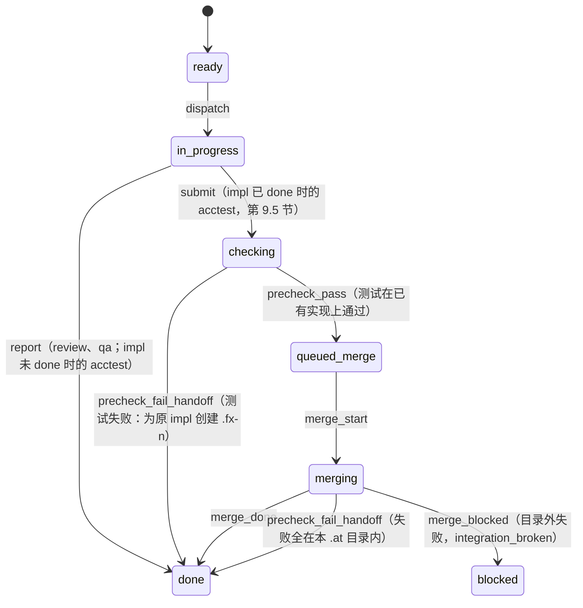
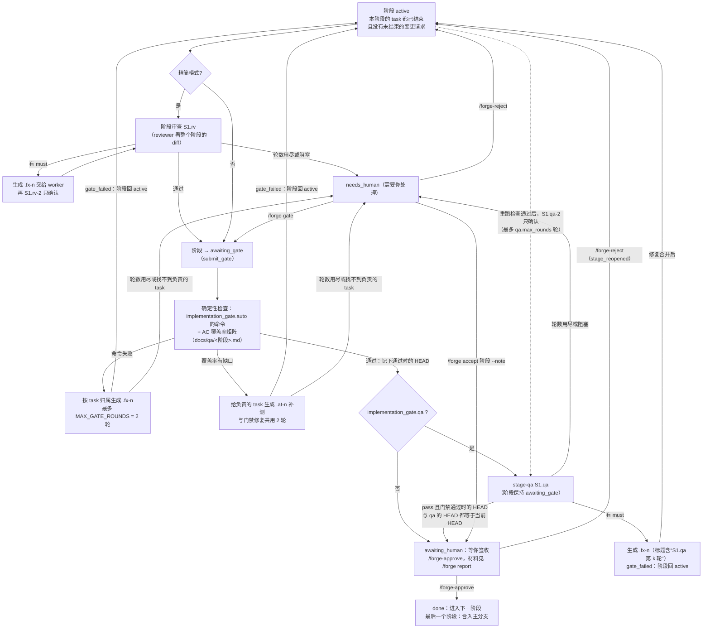
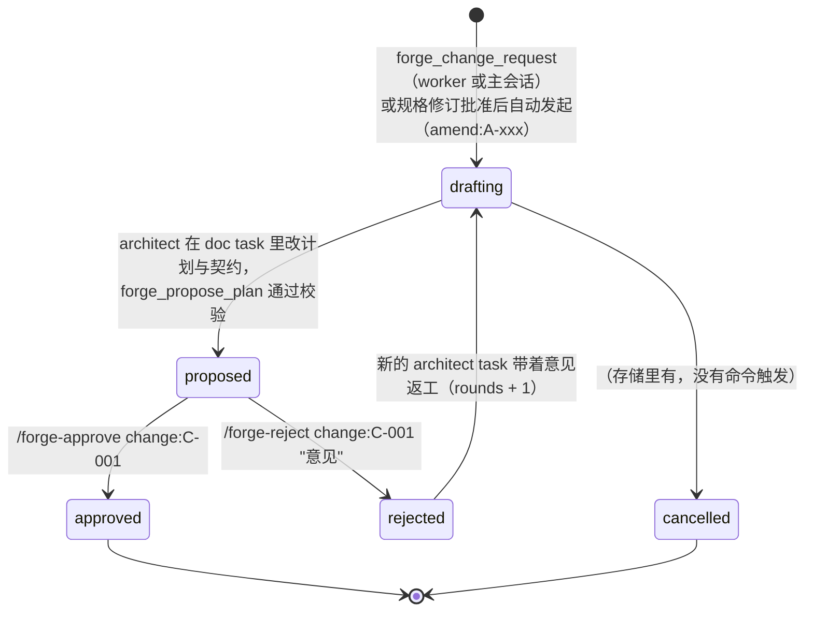
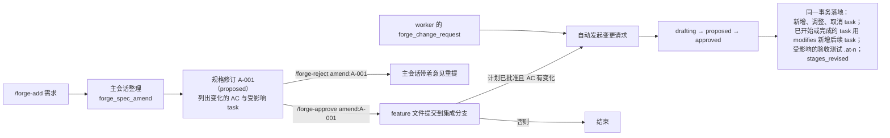
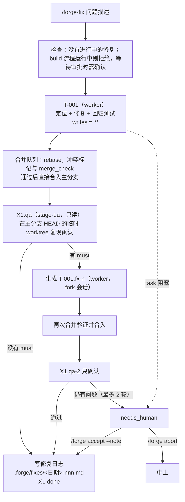

# pi-forge 流程图

这些图按代码里的状态名画：task 状态机是 `src/core/state/state-machine.ts` 的 `TRANSITIONS`，阶段状态机是 `STAGE_TRANSITIONS`，阶段验收编排是 `src/core/stage/stage-acceptance.ts`。规格的章节号指 `docs/BUILD_PROMPT.md`。图只画主要路径，完整的转移条件看代码和测试；与规格不同的地方看 `NOTES.md` 的偏离记录。

## 1. 整体阶段（规格第 5 节）

build、feature、adopt 三种流程共用同一套机制，区别在输入和阶段。

要点：

- 用户界面只显示四个高层阶段：规格 → 契约与计划 → 实施 → 交付（`/forge-status`）；内部阶段 id 在 `--detail`。
- P0 的规格由主会话经 `forge_spec` 提交，程序做 spec-lint 并提交到集成分支，必须人工批准。P1 由程序驱动 architect，不经主会话。
- 批准 P1 时，程序先在主工作区应用规则与命令草案，再根据 `plan.yaml` 生成 S 阶段和 task，契约从此只能追加（偏离第 38 条）。
- feature 流程中，主分支已有的契约从流程开始就锁定（偏离第 69 条）。adopt 流程只有一个阶段 `ADOPT`，architect 只写 `docs/contracts/**` 和 `docs/arch/**`（偏离第 70 条）。
- 交付不是独立阶段：批准最后一个 S 阶段时，签收材料就是交付汇报，批准后合入主分支。
- 阶段之间串行，同一阶段内按 DAG 并行。

### 阶段状态机（`STAGE_TRANSITIONS`）

`abort` 可以从 active、awaiting_gate、awaiting_human、needs_human 转到 aborted。P0、P1 这类设计阶段也用同一套状态（阶段闸门需要人工批准）。

## 2. 单个 task 的状态机（规格第 8.1、9.5 节）

下图是 impl、fix、doc 这类实施 task 的主路径。`done` 和 `cancelled` 是终态，没有出边；需要返工时创建新的派生 task。

任何非终态之间还有这些通用转移：

- `block`：agent、调度器或用户阻塞，转 `blocked`，`blocked_by` 记原因。
- `run_failed`、`run_timeout`、`lease_expired`：计入 `attempts`，达到 `limits.max_attempts` 转 `blocked`（`blocked_by = attempts`）。
- `run_interrupted`、`run_paused`：不计失败。
- `cancel`：`pending`、`ready`、`blocked` 可由用户取消。

计数达到上限时，名义目标会被改为 `blocked`：`precheck_failures` 达到 `limits.max_precheck_failures` 为 `precheck_exhausted`，`merge_failures` 达到 `limits.max_merge_failures` 为 `merge_exhausted`，`review_rounds` 达到 `review.max_rounds` 为 `review_exhausted`。预检或合并次数用尽的 task 只能 `/forge unblock`，不能 `/forge accept`。

### 只读与验收测试 task

要点：

- `review`、`qa` 只走 `ready → in_progress → done`（结论由 `forge_review_report`、`forge_qa_report` 或对应的 confirm 工具提交，要求没有改动）。
- `acctest` 在 impl 尚未 done 时提交即 done，测试随 impl 的预检合入（仅显式开启 test-author 时存在 .at，偏离 118）；impl 已 done 时（S0 的 `.at`、覆盖率缺口、被契约追加破坏、变更请求）走上图的单独合并。
- `.at-n` 的来由有四种：争议、覆盖率缺口、别的 task 的契约追加破坏了测试（第 9.4 节）、变更请求。

## 3. 阶段验收（规格第 11 节；`stage-acceptance.ts`）

一个 S 阶段的 impl 全部结束后的编排。引擎每次 pump 时调用 `stageStep`，它只根据持久化的状态（task、evidence、事件）决定下一步，崩溃后重入结果相同（偏离第 59 条）。

要点：

- 只有"门禁通过时的 HEAD"和"最近一轮 stage-qa 的 HEAD"都等于当前集成分支 HEAD，才进入签收；修复合并之后 HEAD 变了，会重跑门禁和覆盖率，再让 stage-qa 做只确认的一轮。
- 变更请求处于 drafting、proposed 或 rejected 时，阶段门禁等待，因为批准后可能在本阶段新增 task。
- stage-qa 和阶段审查没有自己的 worktree，它们在集成分支 HEAD 的临时 detached worktree 里运行，结束后删除，主工作区没有任何改动（偏离第 62 条）。
- 覆盖率只对计划里有的 S 阶段计算（偏离第 60 条）。
- 签收被打回（`stage_reopened`）后，旧的 qa 与阶段审查轮次仍计入轮数上限，这是已知局限，可以 `/forge accept` 放行。
- 精简模式的 qa 与阶段审查的轮数用尽，也是转 `needs_human`。

## 4. 变更请求的生命周期（规格第 12.3、13.5 节）

变更请求存为 `changes/C-001.json`（偏离第 64 条）。

要点：

- 同一流程同时只能有一个未结束的变更请求（drafting、proposed、rejected 都算未结束），第二个直接拒绝。
- proposed 期间，被它调整的 task 暂停派发（偏离第 65 条）；architect 对契约的修改在你批准前就合入集成分支，当前计划取自最近一个已批准变更请求的 `plan_text`，所以被打回的修订不会污染基线。
- 已开始或已完成的 task 不能直接改或取消；要改就新增 task 并写 `modifies: T-xxx`，程序把它变成硬依赖原 task 的后续 task。
- 变更请求可以在当前阶段新增 task，可以新增或调整当前阶段之后的 S 阶段，不能改已完成的阶段。

## 5. fix 模式（规格第 13.4 节；`src/modes/fix.ts`）

`/forge-fix "<问题>"` 创建一个只有一个阶段 `X1` 的流程，不建 DAG、不跑阶段门禁，不派 `.at`，不做逐任务审查（偏离第 68 条）。

要点：

- 修复直接合入主分支，所以不需要 `/forge-approve`；"需要你处理"时用 `/forge accept --note "<说明>"` 放行。
- `implementation_gate.qa: false` 时跳过复现确认。
- `limits.fix_max_files` 只写进 handoff 提醒 worker，程序不强制。
- 同一时间只允许一个修复；用 `/forge abort` 中止。
