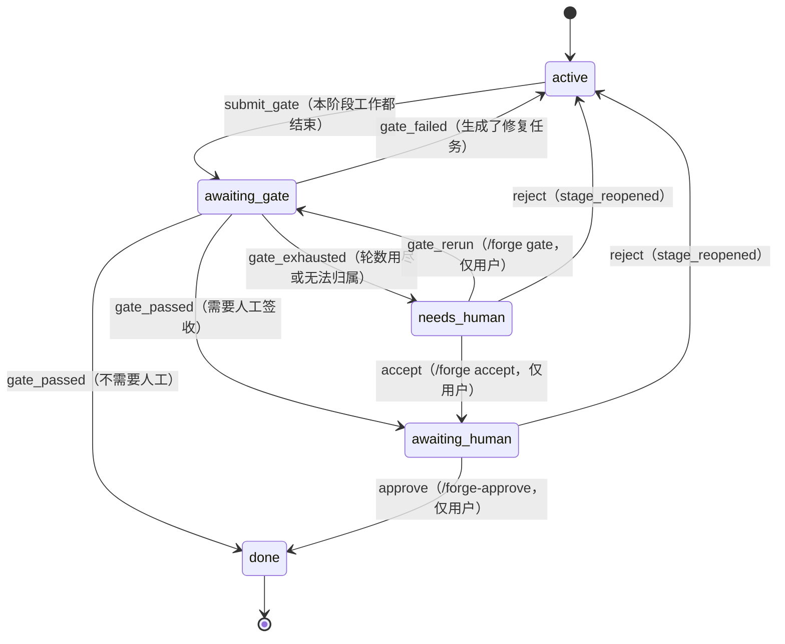
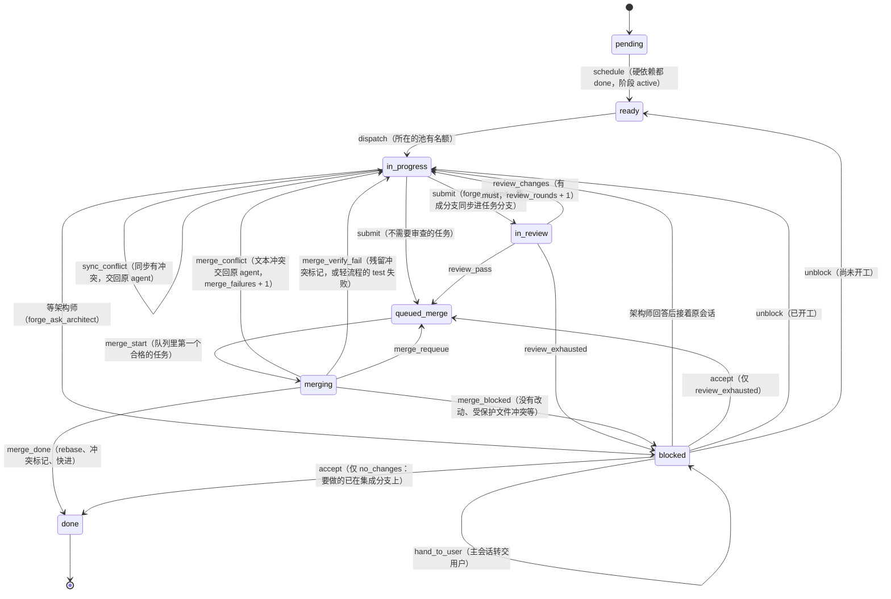
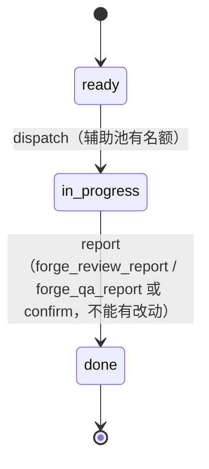
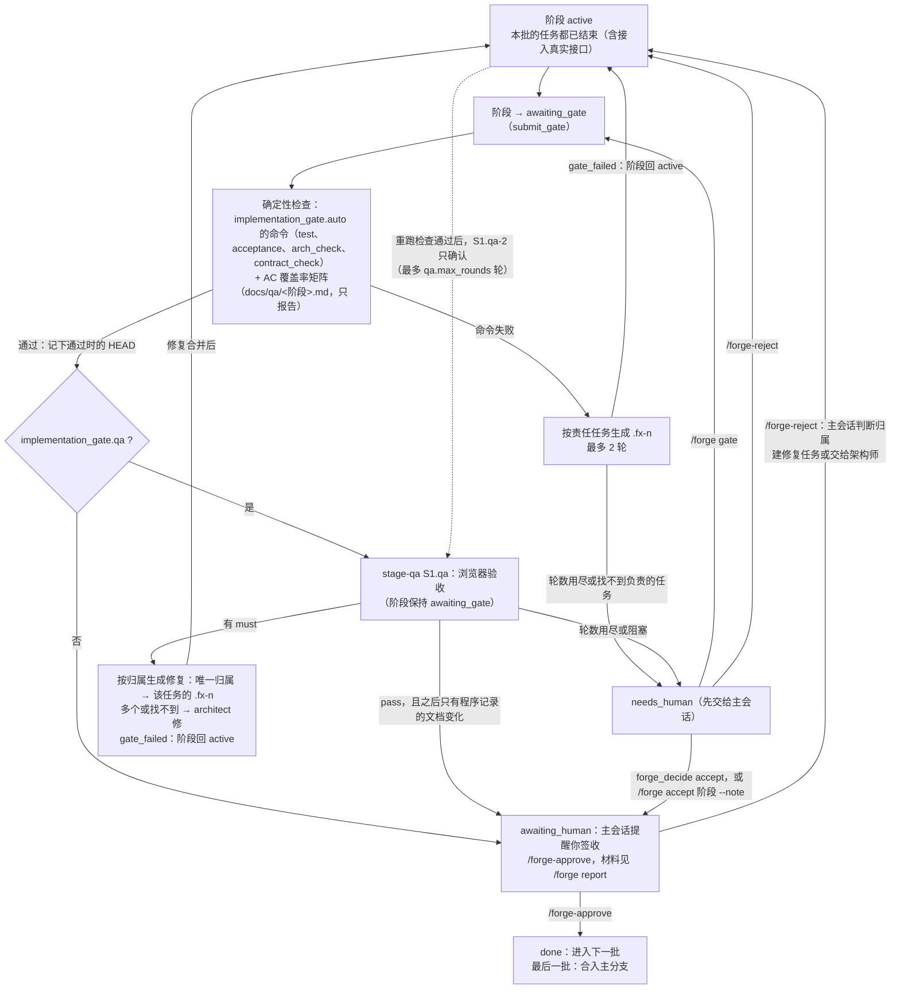
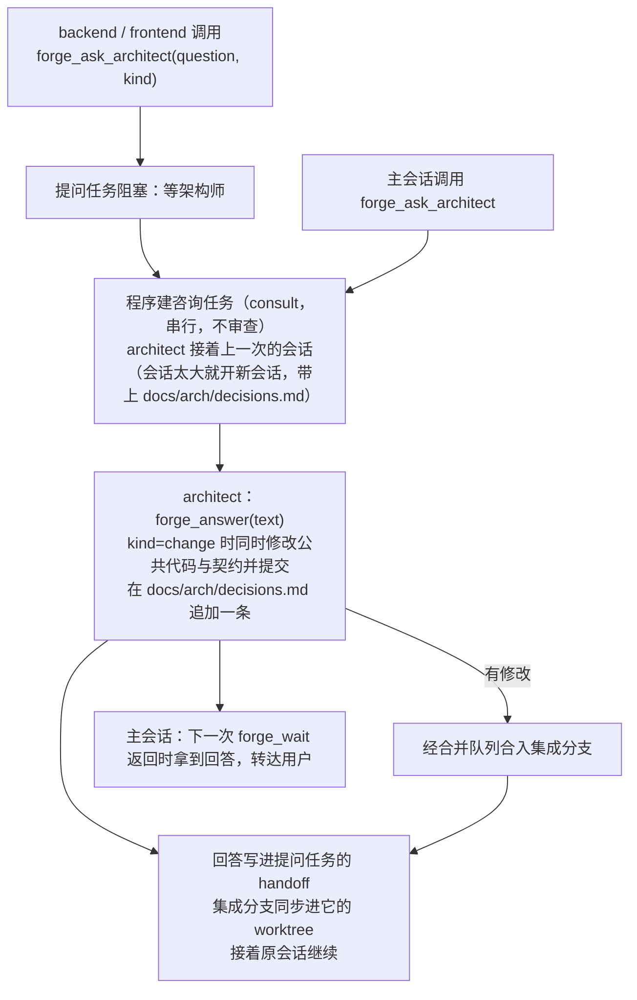
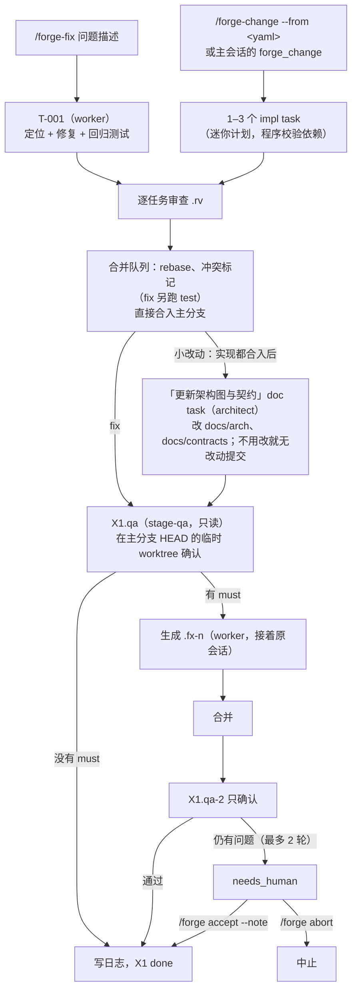

# pi-forge 流程图

这些图按代码里的状态名画：任务状态机是 `src/core/state/state-machine.ts` 的 `TRANSITIONS`，阶段状态机是 `STAGE_TRANSITIONS`，批次验收是 `src/core/stage/stage-acceptance.ts`，架构阶段与批次是 `src/core/plan/plan-flow.ts`、`batches.ts`，fix 与小改动的推进是 `src/modes/fix.ts`。图只画主要路径，完整的转移条件看代码和测试；设计原因看 `NOTES.md`。

## 1. 三种流程

```mermaid
flowchart TD
    subgraph build["build：/forge-build"]
        IN["检查 docs/PRD.md 与 docs/prototype/<br/>缺了只提示，不建流程；齐全则提交到集成分支"] --> S0["S0 架构<br/>architect 一个任务：骨架、公共代码、domain、契约、规则、命令、plan.md"]
        S0 -->|"审查、合并、门禁后<br/>/forge-approve"| GEN["按 plan.md 生成 S1…Sn 与任务<br/>集成分支 --no-ff 合入主分支"]
        GEN --> SN["S1 … Sn（每个批次一个阶段）<br/>后端 domain 并行，前端按页面串行<br/>最后接入真实接口"]
        SN -->|"批次验收后 /forge-approve 签收<br/>最后一批签收时 --no-ff 合入主分支"| BD["交付"]
    end
    subgraph change["小改动：/forge-change --from &lt;yaml&gt; 或 forge_change"]
        C0["迷你计划：1–3 个 impl task（worker）"] --> C1["实施、审查、合并<br/>直接合入主分支"]
        C1 --> C2["更新架构图与契约（architect）"] --> C3["X1.qa 全量确认 → 结束"]
    end
    subgraph fix["fix：/forge-fix 问题描述"]
        F0["T-001（worker）定位、修复、回归测试"] --> F1["审查、合并（跑 typecheck、lint、test）<br/>直接合入主分支"] --> F2["X1.qa 复现确认 → 结束"]
    end
```

要点：

- 用户界面只显示三个高层阶段：架构 → 开发 → 交付（`/forge-status`）；内部阶段 id 在 `--detail`。
- S0 提交时程序检查必需文件与 plan.md 的 yaml 区块，缺文件或调度做不下去就退回，其余只提醒，显示在批准页上。用户打回时 architect 接着原会话返工。
- 批准 S0 时先生成批次再合入主分支；之后中止流程，主分支上的架构产出不撤回。S1 开始前建立共享构建环境，之后各 worktree 链接依赖，不再各自 install。
- 阶段之间串行。批次内：后端任务按 plan 的 `after` 依赖并行（`max_parallel_backend`）；前端同一时间只有 1 个，页面按顺序一个接一个，接着同一会话；接入真实接口等本批全部任务完成。审查、验收、咨询另用辅助池（`limits.max_parallel_aux`），咨询同时最多 1 个。
- 小改动与 fix 是单阶段 `X1` 的轻流程，用 worker 角色，同一时间只能有一个；build 流程运行时拒绝开始。

### 阶段状态机（`STAGE_TRANSITIONS`）

`abort` 可以从 active、awaiting_gate、awaiting_human、needs_human 转到 aborted。S0 也用同一套状态，批准即"架构批准"。

## 2. 单个任务的状态机

下图是 impl、fix、merge-fix 这类开发任务的主路径。`done` 和 `cancelled` 是终态，没有出边；需要返工时创建派生任务（`.fx-n`）。

要点：

- 不需要审查的：fix、merge-fix、接入真实接口；审过之后只因合并冲突退回的，解决后也不再审查。每次合并后，程序在后台对集成分支跑一遍门禁命令，变红时定位到具体任务建修复（见第 3 节）。
- 合并先 rebase；双方都只插入行的冲突由程序三方合并，合不了的交回原 agent。plan.md 的 `shared` 文件提交时若不是只追加，只在审查材料里提醒。
- 通用转移：`block`（agent、调度器或用户阻塞）；`run_failed`、`run_timeout`、`lease_expired` 计入 `attempts`，达到 `limits.max_attempts` 转 blocked；`run_interrupted`、`run_paused` 不计失败；`cancel` 只能由用户对 pending、ready、blocked 执行。
- 子进程没提交就结束时，程序先分类再决定怎么处理：模型额度、限流、配置错误暂停这个模型，不计失败（设了兜底模型时，任务改用兜底模型继续）；运行环境出错直接阻塞；其余计一次失败重试。同样的失败连续两次先换升级模型，再换兜底模型，都试过仍一样就阻塞。
- 计数达到上限时转 blocked：`merge_failures`（`merge_exhausted`）、`review_rounds`（`review_exhausted`）。只有审查轮数用尽的能 accept 放行，其余用 unblock。
- 阻塞先交给主会话（`blocked_owner: orchestrator`）：程序或子进程造成的阻塞，由 orchestrator 用 `forge_decide` 决定 retry（计数清零、带意见重做）、accept 或转交用户（`hand_to_user`）；涉及技术判断的，它先问架构师。主会话自己交出来的、或同一任务它已决定 2 次之后的阻塞，直接等用户。"等架构师"的阻塞不交给主会话。用户始终可以直接 `/forge unblock`、`/forge accept`。

### 只读任务（审查与 stage-qa）

- 逐任务审查 `T-xxx.rv`、`.rv-2` 在被审查任务的 worktree 里运行（只读）；第 2 轮只确认上一轮的 must，不能新增问题。前端页面的审查材料带上原型文件与 page-api.md 里这一页。
- stage-qa `S1.qa`、`S1.qa-2` 在集成分支 HEAD 的临时 detached worktree 里运行，结束后删除。
- 小改动的「更新架构图与契约」是 doc task：有改动时走提交、合并；确实不用改时不改文件直接提交，视为完成（impl、fix 没有改动时也一样）。

## 3. 批次验收（`stage-acceptance.ts`）

一个批次的任务全部结束后的编排。引擎每次 pump 时调用 `stageStep`，它只根据持久化的状态（任务、evidence、事件）决定下一步，崩溃后重入结果相同。

要点：

- 合并后回归测试（`engine/post-merge-test.ts`，`limits.post_merge_test` 默认开）：每次任务合入后在后台对集成分支最新提交跑 `implementation_gate.auto` 的命令。变红时同一提交重跑一次，通过就记为不稳定；仍失败就在上一次通过之后的合并里二分，给第一个变红的合并对应的任务建 `.fx-n`。它在跑时批次门禁先等，门禁沿用同一棵代码树上通过的结果。
- 门禁通过后，与最近一轮 stage-qa 的 HEAD 之间只有程序记录的文档（审查建议、`docs/qa/`）时才进入签收；修复合并之后会重跑门禁与覆盖率，再让 stage-qa 做只确认的一轮。stage-qa 轮数用尽后集成分支又有了改动时，门禁通过后再开一轮只确认的 stage-qa。
- 问题归属：一条问题只交给一个任务修。先看问题涉及的文件是哪个已完成任务改过的，再看 plan.md 的 `paths`，页面文件归该页面的任务；归到唯一一个任务就接着它的会话修，否则建一个由 architect 完成的修复任务。
- 签收被打回（`stage_reopened`）后，旧的 qa 轮次仍计入轮数上限，这是已知局限，可以 `/forge accept` 放行。

## 4. 架构师问答（`forge_ask_architect`、`forge_answer`）

要点：

- `kind`：`answer` 只要回答；`change` 要求修改已有公共内容或契约。新增常量、枚举值、错误码不用问，开发 agent 自己加。
- 改了契约的，由下一次批次门禁里的 `contract_check` 与 stage-qa 兜底。
- `forge_block` 只用于不是技术问题、又做不下去的事（需求矛盾、要用户的环境），仍先交给主会话。

## 5. fix 与小改动（`src/modes/fix.ts`）

两者都是单阶段 `X1` 的轻流程：不跑批次门禁，合并直接进主分支，日志写在 `.forge/fixes/<日期>-nnn.md`。

要点：

- 修复与小改动直接合入主分支，不需要 `/forge-approve`；"需要你处理"时用 `/forge accept --note "<说明>"` 放行。
- `implementation_gate.qa: false` 时跳过 X1.qa。
- 小改动的 task 数上限是 `limits.change_max_tasks`（默认 3）；要改已有契约时，worker 用 forge_block 说明。
