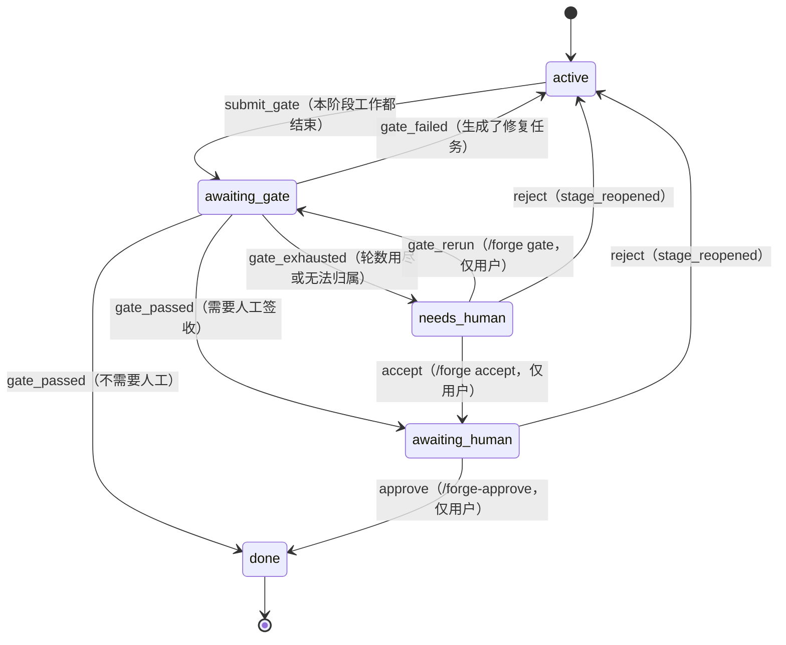
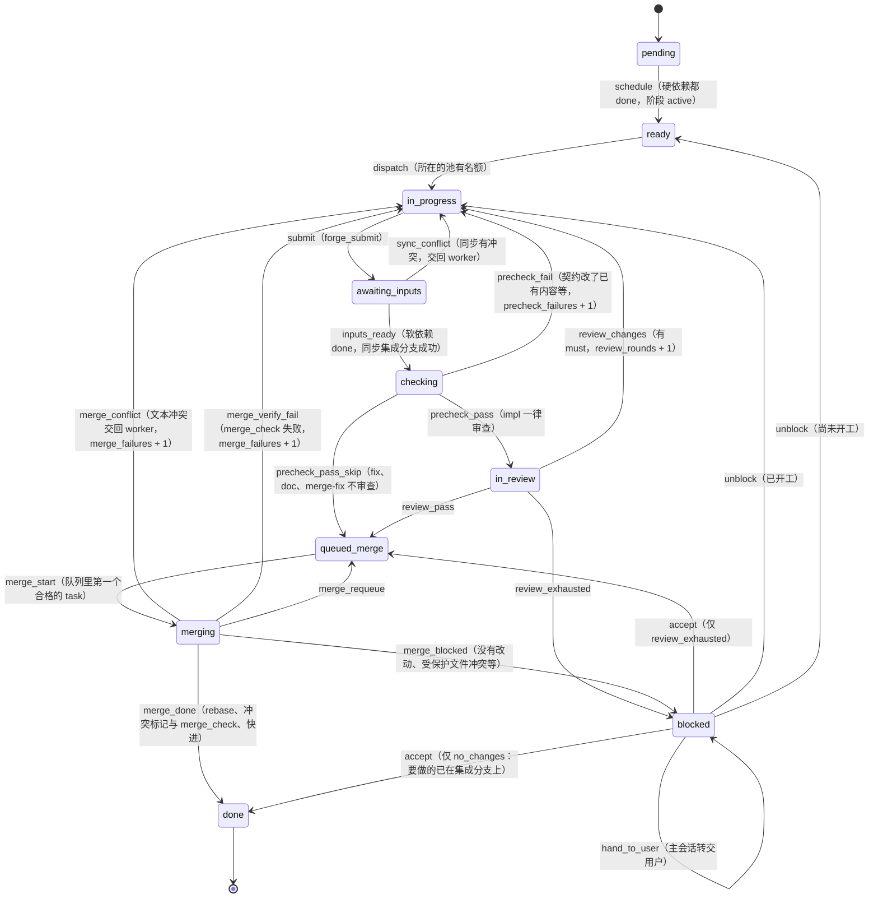
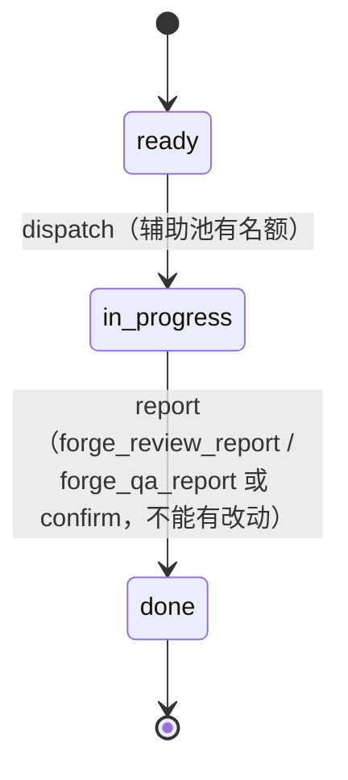
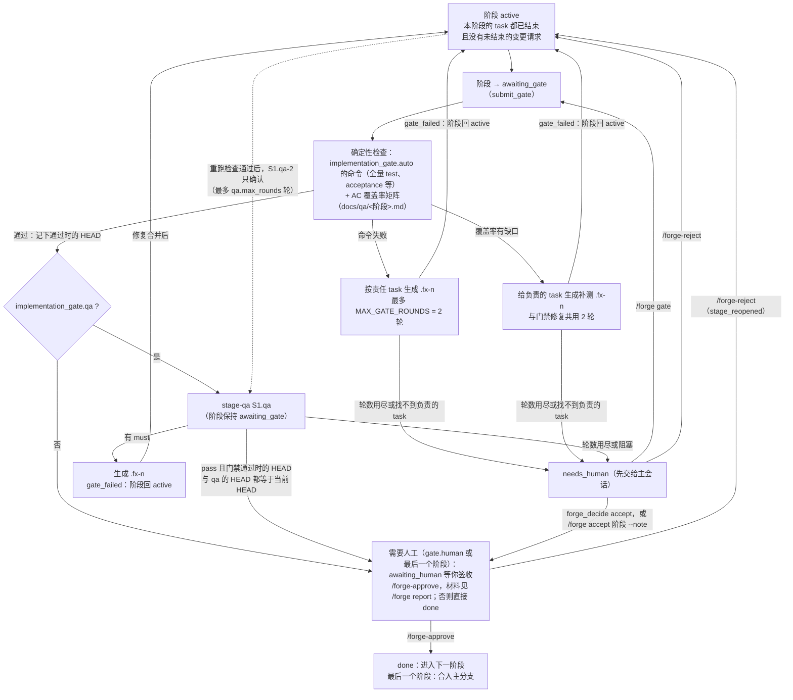
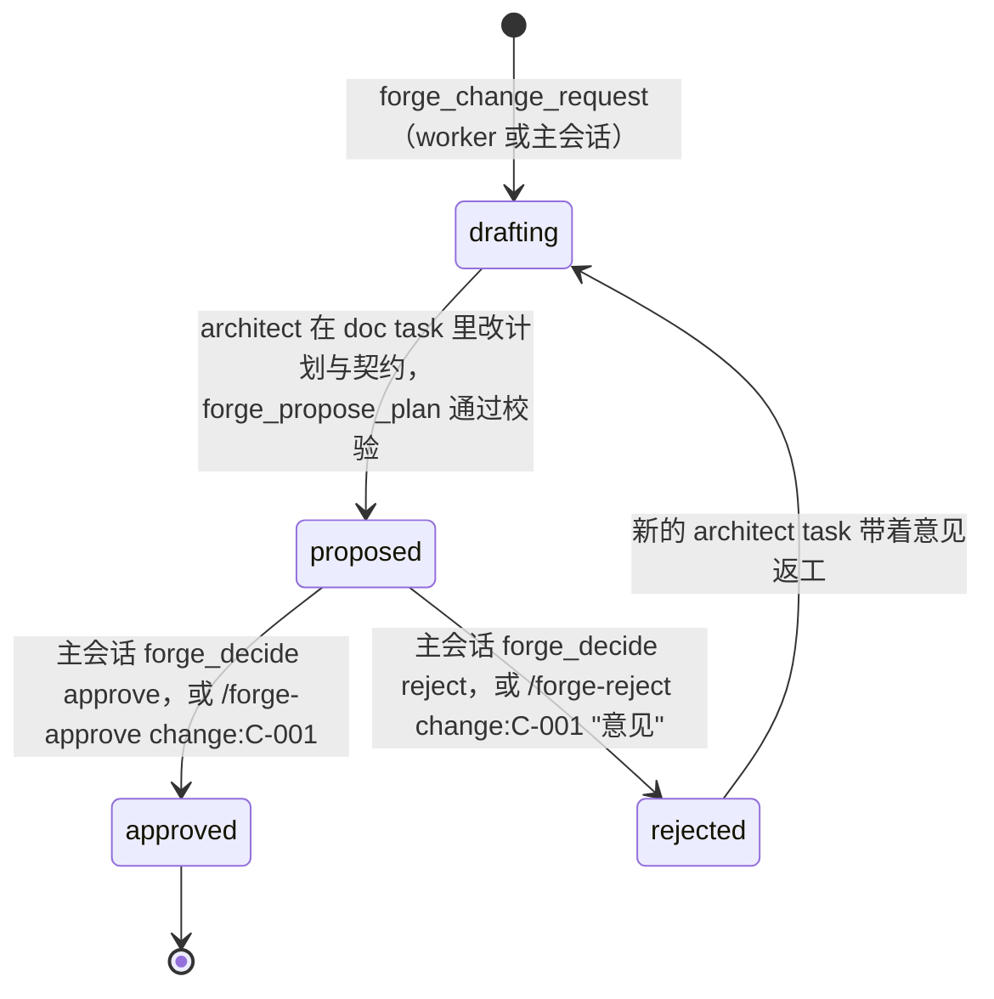
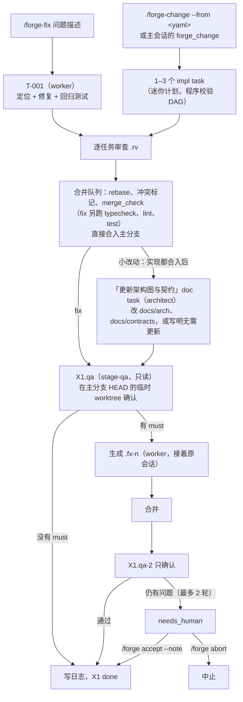

# pi-forge 流程图

这些图按代码里的状态名画：task 状态机是 `src/core/state/state-machine.ts` 的 `TRANSITIONS`，阶段状态机是 `STAGE_TRANSITIONS`，阶段验收是 `src/core/stage/stage-acceptance.ts`，fix 与小改动的推进是 `src/modes/fix.ts`。规格的章节号指 `docs/BUILD_PROMPT.md`。图只画主要路径，完整的转移条件看代码和测试；与规格不同的地方看 `NOTES.md` 的偏离记录。

## 1. 三种流程

```mermaid
flowchart TD
    subgraph build["build：/forge-build"]
        B0["P0 规格<br/>主会话 + 用户，spec-lint"] -->|"/forge-approve"| B1["P1 契约与计划<br/>architect，程序校验"]
        B1 -->|"/forge-approve<br/>应用命令草案，生成 S 阶段与 task，契约只能追加"| S0["S0 骨架<br/>architect：骨架、rules/、共享类型"]
        S0 --> SN["S1 … Sn<br/>阶段开始时建共享构建环境"]
        SN -->|"每个阶段验收后签收<br/>最后一个阶段签收时 --no-ff 合入主分支"| BD["交付"]
    end
    subgraph change["小改动：/forge-change --from &lt;yaml&gt; 或 forge_change"]
        C0["迷你计划：1–3 个 impl task<br/>程序校验，不走 P0/P1 批准"] --> C1["实施、审查、合并<br/>直接合入主分支"]
        C1 --> C2["更新架构图与契约（architect）"] --> C3["X1.qa 全量确认 → 结束"]
    end
    subgraph fix["fix：/forge-fix 问题描述"]
        F0["T-001（worker）定位、修复、回归测试"] --> F1["审查、合并（跑 typecheck、lint、test）<br/>直接合入主分支"] --> F2["X1.qa 复现确认 → 结束"]
    end
```

要点：

- 用户界面只显示四个高层阶段：规格 → 契约与计划 → 实施 → 交付（`/forge-status`）；内部阶段 id 在 `--detail`。
- P0 的规格由主会话经 `forge_spec` 提交，程序做 spec-lint 并提交到集成分支，必须人工批准。P1 由程序驱动 architect，不经主会话。
- 批准 P1 时，程序先在主工作区应用命令草案（`docs/rules-draft/commands.yaml`），再根据 `plan.yaml` 生成 S 阶段和 task；契约从此只能追加。
- S0 只有一个 architect task：建骨架、直接写 `rules/`、把共享类型与错误响应落成代码；S0 合入后 rules 对 S1 起的 task 生效。S1 开始前建立共享构建环境，之后各 worktree 链接依赖，不再各自 install。
- 阶段之间串行，同一阶段内按 DAG 并行：实施 task 用 `limits.max_parallel`，审查与 stage-qa 另用 `limits.max_parallel_aux`；writes 重叠的 task 优先错开，没别的可派时也并行。
- 小改动与 fix 是单阶段 `X1` 的轻流程，同一时间只能有一个；build 流程运行时拒绝开始。

### 阶段状态机（`STAGE_TRANSITIONS`）

`abort` 可以从 active、awaiting_gate、awaiting_human、needs_human 转到 aborted。P0、P1 这类设计阶段也用同一套状态（阶段闸门需要人工批准）。

## 2. 单个 task 的状态机（规格第 8.1 节）

下图是 impl、fix、doc、merge-fix 这类实施 task 的主路径。`done` 和 `cancelled` 是终态，没有出边；需要返工时创建派生 task（`.fx-n`）。

要点：

- 预检不跑命令，只检查契约只能追加；reviewer 读代码、运行本 task 的单元测试和验收测试。每次合并后，程序在后台对集成分支跑一遍门禁命令，变红时定位到具体 task 建修复（见第 3 节）。
- 合并先 rebase；双方都只插入行的冲突（契约与普通文件）由程序三方合并，合不了的交回正在合并的 worker。doc 等其他种类与主分支同步时的冲突走 merge-fix。
- 通用转移：`block`（agent、调度器或用户阻塞）；`run_failed`、`run_timeout`、`lease_expired` 计入 `attempts`，达到 `limits.max_attempts` 转 blocked；`run_interrupted`、`run_paused` 不计失败；`cancel` 只能由用户对 pending、ready、blocked 执行。
- 子进程没提交就结束时，程序先分类再决定怎么处理：模型额度、限流、配置错误暂停这个模型，不计失败（设了兜底模型时，任务改用兜底模型继续）；运行环境出错直接阻塞；其余计一次失败重试。同样的失败连续两次先换升级模型，再换兜底模型，都试过仍一样就阻塞。
- 计数达到上限时转 blocked：`precheck_failures`（`precheck_exhausted`）、`merge_failures`（`merge_exhausted`）、`review_rounds`（`review_exhausted`）。只有审查轮数用尽的能 accept 放行，其余用 unblock。
- 阻塞先交给主会话（`blocked_owner: orchestrator`）：程序或子进程造成的阻塞，由 orchestrator 用 `forge_decide` 决定 retry（计数清零、带意见重做）、accept 或转交用户（`hand_to_user`）。主会话自己交出来的、或同一 task 它已决定 2 次之后的阻塞，直接等用户。用户始终可以直接 `/forge unblock`、`/forge accept`。

### 只读 task（审查与 stage-qa）

- 逐任务审查 `T-xxx.rv`、`.rv-2` 在被审查 task 的 worktree 里运行（只读）；第 2 轮起只确认上一轮的 must，不能新增问题。
- stage-qa `S1.qa`、`S1.qa-2` 在集成分支 HEAD 的临时 detached worktree 里运行，结束后删除。
- 小改动的「更新架构图与契约」是 doc task：有改动时走提交、合并；确实不用改时写明「无需更新：原因」后直接 `report` 完成。

## 3. 阶段验收（规格第 11 节；`stage-acceptance.ts`）

一个 S 阶段的 task 全部结束后的编排。引擎每次 pump 时调用 `stageStep`，它只根据持久化的状态（task、evidence、事件）决定下一步，崩溃后重入结果相同。

要点：

- 合并后回归测试（`engine/post-merge-test.ts`，`limits.post_merge_test` 默认开）：每次 task 合入后在后台对集成分支最新提交跑 `implementation_gate.auto` 的命令。变红时同一提交重跑一次，通过就记为不稳定；仍失败就在上一次通过之后的任务合并里二分，给第一个变红的合并对应的 task 建 `.fx-n`，附失败输出。它在跑时阶段门禁先等，门禁沿用同一棵代码树上通过的结果。
- 只有"门禁通过时的 HEAD"和"最近一轮 stage-qa 的 HEAD"都等于当前集成分支 HEAD，才进入签收；修复合并之后 HEAD 变了，会重跑门禁和覆盖率，再让 stage-qa 做只确认的一轮。
- 修复任务归属：先看各 task 合入时实际改动的文件，再看 writes，都没有时给本阶段最后合入的 impl。
- 变更请求处于 drafting、proposed 或 rejected 时，阶段门禁等待，因为批准后可能在本阶段新增 task。
- 覆盖率只对计划里有的 S 阶段计算。
- 签收被打回（`stage_reopened`）后，旧的 qa 轮次仍计入轮数上限，这是已知局限，可以 `/forge accept` 放行。

## 4. 变更请求（规格第 12.3 节）

实施中发现计划或契约要改时，worker 或主会话用 `forge_change_request` 发起，存为 `changes/C-001.json`。

要点：

- 同一流程同时只能有一个未结束的变更请求（drafting、proposed、rejected 都算），第二个直接拒绝。
- 修订就绪后先交给主会话审核：批准、打回（最多打回到第 3 轮），或转交用户；转交后只有用户能批准或打回。
- architect 的说明里带上发起 task 在 worktree 里的改动统计与 handoff，不用去读别的 worktree。
- proposed 期间，被它调整的 task 暂停派发；architect 对契约的修改在你批准前就合入集成分支，当前计划取自最近一个已批准变更请求的 `plan_text`，所以被打回的修订不会污染基线。
- 批准时在一个事务里落地：新增、调整、取消 task；已开始或已完成的 task 不能直接改，要新增 task 并写 `modifies: T-xxx`，程序把它变成硬依赖原 task 的后续 task。可以新增或调整当前阶段及之后的 S 阶段，不能改已完成的阶段。
- 只追加的改动不需要变更请求：给已有契约加可选参数、新接口、新字段算追加。

## 5. fix 与小改动（`src/modes/fix.ts`）

两者都是单阶段 `X1` 的轻流程：不建 DAG、不跑阶段门禁，合并直接进主分支，日志写在 `.forge/fixes/<日期>-nnn.md`。

要点：

- 修复与小改动直接合入主分支，不需要 `/forge-approve`；"需要你处理"时用 `/forge accept --note "<说明>"` 放行。
- `implementation_gate.qa: false` 时跳过 X1.qa。
- 小改动的 task 数上限是 `limits.change_max_tasks`（默认 3）；改动超出计划太多或要改已有契约时，worker 用 forge_block 说明。
